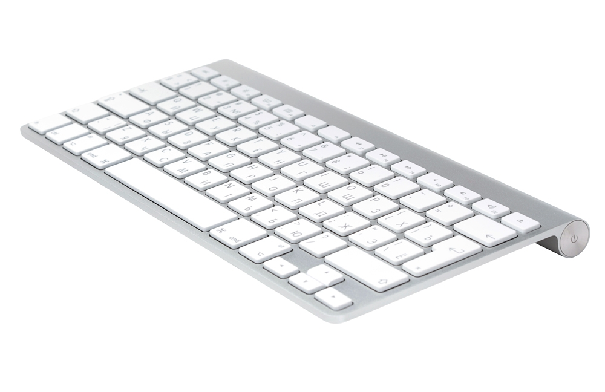

# WinAppleKey

**Русский** · [English](README.md)

Драйвер для Apple Magic Keyboard (A1644) и Apple Wireless Keyboard (A1314) под Windows **с работающими мультимедийными клавишами!** Раскладка как на ThinkBook.



Это форк [samartzidis/WinAppleKey](https://github.com/samartzidis/WinAppleKey) — оригинального драйвера для A1644 под Windows 10, который сейчас в архиве. Поддержка A1314 взята из [форка jeba1215](https://github.com/jeba1215/WinAppleKey); поверх неё здесь добавлены настоящие медиа-клавиши, громкость, яркость, сон и гибернация, а также MSI-установщик.

Windows и так печатает с A1314, клавиатура не сломана. Чего нет — привычного левого нижнего угла. Крайняя левая клавиша работает как [Fn], а не [Ctrl], [Delete] спрятан под [Fn], [⏏ eject] ничего не делает, а клавиши медиа, громкости и яркости мертвы. Этот драйвер это исправляет.

Проверено на A1314 (ISO, PID `0x0256`) по Bluetooth на Windows 11 24H2, сборка 26100, на ноутбуке Lenovo ThinkBook — именно на нём отлаживались [Fn]-слой, клавиши яркости и поведение [Alt]+[Tab]. Часть для A1644 досталась от исходного проекта, но этой клавиатуры у меня нет, так что после моих правок её никто не перепроверял. Считай, что проторённая дорога — это A1314.

## Клавиши

Комбинации [Fn] набираются с зажатым физическим [Ctrl]. Да, именно [Ctrl] — для этого и сделан свап [Fn]/[Ctrl].

| Ты нажимаешь | Ты получаешь |
| --- | --- |
| [Fn]+[F1], [Fn]+[F2] | яркость меньше, яркость больше |
| [Fn]+[F3] | [Win]+[Tab], Task View |
| [Fn]+[F4] | [Win]+[Z], Snap Layouts |
| [Fn]+[F5] | сон |
| [Fn]+[F6] | гибернация |
| [Fn]+[F7], [F8], [F9] | предыдущий трек, play/pause, следующий трек |
| [Fn]+[F10], [F11], [F12] | mute, тише, громче |
| [Fn]+[←] | [Home] |
| [Fn]+[→] | [End] |
| [Fn]+[↑] | [Page Up] |
| [Fn]+[↓] | [Page Down] |
| [Fn]+[Return] | [Insert] |
| [Fn]+[P], [Fn]+[S], [Fn]+[B] | [Print Screen], [Scroll Lock], [Pause/Break] |
| [Fn]+[Ctrl] | [Right Ctrl] |

[⏏ eject] — это [Delete].

Любая другая комбинация [Fn]+клавиша намеренно проглатывается. [Fn] никогда не доходит до Windows как [Ctrl], так что случайно ничего не сработает, и недонабранное [Fn]-сочетание не начнёт делать странное в том окне, которое оказалось в фокусе.

Слева [fn] и [Ctrl] поменяны местами, [⌥ alt] становится [Win], [⌘ cmd] — [Alt]. Справа всего две клавиши, и одна из них — контекстное меню. По умолчанию правый [⌘ cmd] — это [Alt], а правый [⌥ alt] открывает меню. Если хочешь меню на [⌘ cmd], поставь `SwapRightCmdAlt` в 0.

Этот [Alt] — именно **левый**, и так задумано. Windows считает [Right Alt] за AltGr, а переключатель окон не воспринимает отпускание `VK_RMENU` как «подтвердить» — с ним список окон висит на экране и ждёт [Enter].

Одна вещь, на которой спотыкаются: [Alt], [Ctrl] и [Win] сами по себе ничего не делают. Нажал правый [⌥ alt], ничего не произошло — это нормально. Попробуй [⌥ alt]+[Tab].

## Как это работает

Драйвер — нижний фильтр на узле HID-устройства, то есть он сидит между транспортом (USB или Bluetooth) и HIDCLASS и успевает переписать входные отчёты раньше, чем их кто-то разберёт. Пользовательского софта нет.

На проводе клавиатуры выглядят по-разному. A1644 шлёт 11-байтные отчёты. A1314 шлёт 10-байтные клавиатурные плюс 3-байтные «специальные», в младших битах которых едут [⏏ eject] и [Fn]. `A1314.c` и `A1644.c` знают свою раскладку и переводят её, дальше оба идут через одни и те же правила.

Громкости и яркости понадобился другой трюк. В дескрипторе A1314 вообще нет usages Mute, Volume и Brightness, а те, что есть на клавиатурной странице, Windows игнорирует — переписывать в отчёте было нечего. Поэтому драйвер ставится ещё и как маленькое root-перечислимое устройство и создаёт виртуальный Consumer Control через Virtual HID Framework. Windows видит вторую, обычную мультимедийную клавиатуру с Mute, Vol+/Vol- и Brightness+/Brightness-, и [Fn]+[F1]/[F2] вместе с [Fn]+[F10]..[F12] шлют отчёты уже ей. Поэтому же в диспетчере устройств появляется «WinAppleKey Virtual HID Device».

Яркость — то, что удивило меня самого. Внешние клавиатуры с клавишами яркости на ноутбуках под Windows обычно не делают ничего, так что я ждал, что эти usages тоже проигнорируют. Не проигнорировали: `0x6F`/`0x70` идут прямо во встроенную панель, и в логе видно, что яркость меняется примерно через 7 мс после отчёта. Внешний монитор он не тронет — это уже DDC/CI, отдельная история.

Сон и гибернация — вообще не HID, поэтому драйвер разговаривает с менеджером питания напрямую. Очевидный вызов, `NtSetSystemPowerState`, как выяснилось, ntoskrnl не экспортирует; экспортируется `ZwInitiatePowerAction`. Ему нужен PASSIVE_LEVEL, а отчёты разбираются в completion routine, которая может исполняться на DISPATCH_LEVEL, так что вызов уезжает в рабочий поток. Клавиши срабатывают только по нажатию, никогда по удержанию. Версия по уровню отправляла бы машину обратно в сон сразу после пробуждения.

## Установка

Есть MSI, который делает всё перечисленное ниже, включая сертификат и виртуальное устройство — см. «Сборка установщика». Ручной путь здесь для тех, кто хочет видеть, что происходит, или сделать всё самому.

Драйвер подписан самодельным тестовым сертификатом, поэтому Windows загрузит его только при включённом **TESTSIGNING**. Если включён Secure Boot, сначала придётся выключить его в прошивке. На Windows 10 1607 и новее, включая 11, нужно ещё выключить целостность памяти (изоляция ядра), иначе тестово подписанные драйверы отвергаются при любых раскладах.

```
bcdedit /set TESTSIGNING ON
```

Потом перезагрузка. Постоянно работать в TESTSIGNING — значит осознанно ослаблять систему, так что реши, готов ли ты на этот размен, прежде чем начинать. Это бесплатный софт, который ты ставишь на свой страх и риск.

Собери драйвер и доверься сертификату, который создала сборка. Он лежит рядом с драйвером как `WinAppleKey\x64\<Configuration>\WinAppleKey.cer` и генерируется автоматически при первой сборке:

```
certutil -addstore -f Root             WinAppleKey\x64\Release\WinAppleKey.cer
certutil -addstore -f TrustedPublisher WinAppleKey\x64\Release\WinAppleKey.cer
pnputil /add-driver WinAppleKey\x64\Release\WinAppleKey\WinAppleKey.inf /install
```

Файлы `.cer`, `.pfx` и `.pvk` рядом с исходниками — от автора оригинала, они больше не используются.

Последняя команда ставит фильтр клавиатуры. Клавишам громкости нужен ещё один шаг, потому что живут они на отдельном виртуальном устройстве:

```
devcon install WinAppleKey\x64\Release\WinAppleKey\WinAppleKey.inf root\WinAppleKeyVhf
```

`devcon.exe` идёт в составе WDK. Пропустишь — всё остальное работает, кроме [Fn]+[F1]/[F2] и [Fn]+[F10]..[F12], которые просто ничего не сделают.

**Переустановка.** `pnputil /delete-driver ... /uninstall` не всегда удаляет корневой узел виртуального устройства. Если он остался, `pnputil /add-driver /install` подхватит его, а потом `devcon install` создаст второй. Хэндл VHF в драйвере один на весь драйвер, поэтому второй хост удаляет устройство первого — а после удаления любого из хостов виртуального устройства не остаётся вообще. Симптом неприятный: клавиатура работает, всё, что не зависит от виртуального устройства, работает, и только громкость с яркостью молча мертвы.

Поэтому перед `add-driver` при переустановке убедись, что ничего не осталось:

```
devcon remove root\WinAppleKeyVhf
```

`devcon remove` принимает hardware ID и снимает все подходящие узлы — здесь это как раз то, что нужно. После должно остаться ровно одно устройство с hardware ID `root\WinAppleKeyVhf`. Если их всё-таки два, сними оба и один раз выполни строку `devcon install`. Если устройство одно, а громкость с яркостью мертвы — перезапусти его, это заново прогонит `VhfInit` и создаст виртуальное устройство:

```
pnputil /restart-device "ROOT\HIDCLASS\0000"
```

Чтобы снести всё: сначала виртуальное устройство, потом пакет, потом выключить тестовую подпись:

```
devcon remove root\WinAppleKeyVhf
pnputil /delete-driver oemXX.inf /uninstall /force
bcdedit /set TESTSIGNING OFF
```

## Настройки

Четыре DWORD в `HKLM\SYSTEM\CurrentControlSet\Services\WinAppleKey`.

| Значение | По умолчанию | Что делает |
| --- | --- | --- |
| `SwapFnCtrl` | 1 | [fn] и [Ctrl] меняются местами |
| `SwapAltCmd` | 1 | [⌥ alt] и [⌘ cmd] меняются местами, только слева |
| `RightCmdAsMenu` | 1 | один из правых модификаторов становится клавишей контекстного меню |
| `SwapRightCmdAlt` | 1 | 1: правый [⌥ alt] открывает меню, правый [⌘ cmd] работает как [Alt]. 0: правый [⌘ cmd] открывает меню, правый [⌥ alt] работает как [Alt] |

Живут они в ключе службы драйвера, поэтому полное удаление уносит их с собой, и следующая установка начинает с дефолтов из INF. Стоит помнить, если меняешь что-то, а потом переставляешь пакет.

Читаются они один раз, при загрузке драйвера, так что после изменения нужна перезагрузка или переустановка. Переустановка быстрее:

```
pnputil /delete-driver oemXX.inf /uninstall /force
devcon remove root\WinAppleKeyVhf
pnputil /add-driver WinAppleKey\x64\Release\WinAppleKey\WinAppleKey.inf /install
devcon install WinAppleKey\x64\Release\WinAppleKey\WinAppleKey.inf root\WinAppleKeyVhf
```

Последняя строка не опциональна — переустановка уносит виртуальное устройство с собой, а без неё громкость и яркость пропадут. Если не вернулись, см. выше про остатки.

## Сборка

Visual Studio 2019 или новее плюс WDK. Проект собирается и с Windows 10 WDK (10.0.19041.0), и с 24H2 (10.0.26100.0), но `vhfkm.lib` должен быть из 19041 — в установленном у меня 26100 он есть только частично. Подключён через `AdditionalDependencies` в файле проекта.

```
msbuild WinAppleKey\WinAppleKey.vcxproj /t:Rebuild /p:Configuration=Release /p:Platform=x64
```

Сборка сама подписывает `.sys` и `.cat` тестовым сертификатом, так что отдельного шага подписи нет. Сертификат ищется по subject, поэтому его нужно один раз создать до первой сборки:

```
New-SelfSignedCertificate -Type CodeSigningCert -Subject 'CN=WinAppleKey Test Certificate' -CertStoreLocation Cert:\CurrentUser\My -KeyExportPolicy Exportable -NotAfter (Get-Date).AddYears(10)
```

Если дать WDK сгенерировать свой, он назовёт его по учётной записи и машине (`WDKTestCert <user>,<ticks>`), и это имя уедет в `.sys`, `.cat` и MSI — в релиз такое отдавать не стоит.

Версии четырёхпольные и начинаются с нуля: `0.1.1.11`. В MSI попадают три хвостовых, `1.1.11`, потому что MSI сравнивает только три; ведущий ноль просто говорит, что это не коммерческий релиз. Менять надо одновременно `DriverVer` в `WinAppleKey.inf`, числа в `resource.rc` и `Version` в `Setup.wixproj`.

Код разложен по задачам: `Driver.c` — обвязка IRP, `A1314.c` и `A1644.c` переводят два формата отчётов, `Vhf.c` — виртуальное устройство, `Power.c` — сон и гибернация.

## Сборка установщика

В `Setup` лежит WiX-проект MSI. Сборка solution делает всё по порядку: сначала драйвер, потом `DeviceTool.exe`, потом пакет:

```
msbuild WinAppleKey.sln /t:Rebuild /p:Configuration=Release /p:Platform=x64
```

Результат — `Setup\x64\Release\WinAppleKey-Setup.msi`. Он кладёт сертификат в `Root` и `TrustedPublisher`, копирует драйвер в `%ProgramFiles%\WinAppleKey`, ставит пакет и создаёт root-перечислимое устройство, на котором живёт виртуальный HID. Удаление выносит всё это обратно, вместе с сертификатом. При выключенном TESTSIGNING ставиться отказывается — драйвер всё равно не загрузится.

Аккуратности потребовало именно удаление. Фильтр-драйвер, который всё ещё привязан к клавиатуре, остановить нельзя — вызов просто не возвращается, и установщик на нём виснет, поэтому в пакете намеренно нет `ServiceControl` со `Stop`. Вместо этого сначала снимается узел устройства, DIFxApp забирает пакет (и фильтр отвязывается), и только после этого `DeviceTool cleanup` удаляет службу и копию `.sys`, которую INF оставляет в `System32\drivers`. Всё удаление занимает около двух секунд и не оставляет следов.

WiX v3 здесь не ставится в систему: `WixBinDir` должен указывать на его папку `bin`. Пропиши один раз в системе (`setx WixBinDir C:\путь\к\wix`) или передавай `/p:WixBinDir=...` при сборке. В проекте путь нигде не зашит.

`Setup\DeviceTool` — маленькая консольная программа, которая создаёт и удаляет это корневое устройство. Встроенного аналога в Windows нет: `pnputil` ставит драйвер на уже существующее устройство, но создать его не может, а таскать с собой `devcon.exe` из WDK — значит распространять инструмент Microsoft. Заодно она ставится в `%ProgramFiles%\WinAppleKey`, что удобно, когда виртуальное устройство залипло:

```
DeviceTool.exe remove root\WinAppleKeyVhf
DeviceTool.exe create root\WinAppleKeyVhf "C:\Program Files\WinAppleKey\WinAppleKey.inf"
DeviceTool.exe cleanup WinAppleKey WinAppleKey.sys
```

`cleanup` — помощник удаления: останавливает службу (ждёт не больше трёх секунд), удаляет её и стирает `.sys` из `System32\drivers`, делая короткие повторы, потому что PnP отпускает файл асинхронно. Если файл всё ещё отображён и после этого, она намеренно оставляет его на месте: при обновлении старая версия удаляется, пока драйвер загружен, и заказ на удаление при перезагрузке снёс бы копию, которую только что положила новая версия. Оставшийся файл безвреден — службы и пакета нет, грузить его нечему, а следующая установка его перезапишет.

## Если полезешь в виртуальное HID-устройство

Прочитай до того, как полезешь, потому что режим отказа здесь — багчек, а не сообщение об ошибке.

**FDO нужно приаттачить.** `VhfCreate` находит `vhf.sys` через `IoGetLowerDeviceObject` на том device object, который ты ему дал. У корневого устройства, созданного голым `IoCreateDevice`, ниже ничего нет, поэтому получаешь `STATUS_INVALID_PARAMETER` и ни намёка на причину. Сначала вызови `IoAttachDeviceToDeviceStack`. KMDF делает это сам внутри `WdfDeviceCreate` — поэтому примеры из документации просто работают.

**`reportBuffer` начинается с report ID.** `HID_XFER_PACKET` ждёт `{reportId, data...}`, и `reportBufferLen` должен включать этот байт. В примерах miniport из WDK это видно по `packet.reportBuffer + sizeof(packet.reportId)`. Дашь буфер только с данными — HIDCLASS прочитает твой первый байт данных как report ID и молча выбросит весь отчёт.

**Удаляй виртуальное устройство до того, как вниз уйдёт запрос на удаление.** `vhf.sys` — это KMDF-драйвер; если вызвать `VhfDelete` после форварда `IRP_MN_REMOVE_DEVICE`, ты разговариваешь с фильтром, который уже разбирают, и получаешь `0x50 PAGE_FAULT_IN_NONPAGED_AREA` внутри `wdf01000.sys`. Удаляй первым и не давай отчётам лезть в это время (хватит спинлока и флага).

**Биты отчёта назначаются в порядке объявления.** Usages в дескрипторе становятся битом 0, битом 1, битом 2 и так далее, так что вставка usage в середину молча сдвигает всё после неё. Добавляешь новый — держи `VhfBit*` в `Driver.h` в ногу с дескриптором в `Vhf.c`. Про яркость (`0x6F`/`0x70`) тоже стоит знать: выглядит как usage, который Windows проигнорирует, но она работает.

**Хэндл VHF один на весь драйвер, а не по одному на устройство.** Пока существует ровно один узел `root\WinAppleKeyVhf`, это нормально, но дубликаты становятся активно вредными: `VhfInit` второго хоста удаляет виртуальное устройство первого, а выживший хост новое не создаст, пока его не перезапустят. Если громкость и яркость перестали работать, а остальной драйвер в порядке — сначала ищи два корневых узла, а потом уже смотри в код.

В INF есть ещё одна вещь: корневому устройству нужен `LowerFilters = vhf`, а его `AddService` — флаг `SPSVCINST_ASSOCSERVICE`, иначе PnP откажется ставить его как функциональный драйвер.

Всё это гораздо проще сделать неправильно, чем отладить на машине, за которой сидишь. Делай в виртуалке и с Driver Verifier, натравленным на драйвер.

## Вопросы

**Можно подписать по-настоящему, чтобы не включать TESTSIGNING?**
Нет. Драйверам режима ядра нужен EV-сертификат плюс аттестация Microsoft, а это зарегистрированная компания и настоящие деньги. Это хобби-проект, так что остаётся тестовая подпись.

**TESTSIGNING не включается: «The value is protected by Secure Boot policy».**
Включён Secure Boot. Выключи его в прошивке.

**Мультимедийные клавиши не работают.**
Теперь работают, нативно. [Fn]+[F7]..[F9] шлют настоящие Consumer usages, и Windows обрабатывает их сама.

**Яркость ничего не делает.**
[Fn]+[F1]/[F2] идут через виртуальное устройство, так что без него это тихие no-op — проверь, что «WinAppleKey Virtual HID Device» на месте. И должна быть встроенная панель, которую можно гасить: usages достают до экрана ноутбука, но не до внешнего монитора.

**[Ctrl]+[Shift]+[T] не открывает закрытую вкладку в Chrome.**
Теряется не драйвером, а клавиатурой: в [fn] + [Left Shift] + [T] контроллер A1314 вообще не отдаёт T. Те же модификаторы с другой клавишей работают: [Ctrl]+[Shift]+[Esc] открывает диспетчер задач. Значит, дело в самой T, а не в модификаторах. Рабочий вариант — [Ctrl]+[Right Shift]+[T].

**[F5] ничего не делает, или машина сразу просыпается.**
Платформа может не поддерживать запрошенное состояние сна; у машин с Modern Standby нет S3, вместо него S0 low-power idle. Для гибернации проверь, что она вообще включена (`powercfg /h on`) — иначе [F6] молча ничего не делает.

**Почему в системе второе «WinAppleKey Virtual HID Device»?**
Это виртуальное Consumer Control, которое даёт яркость и клавиши громкости. Уберёшь это устройство — потеряешь их, и больше ничего.

**Правый [⌥ alt] / [⌘ cmd] ничего не делает.**
Это модификатор. Модификаторы сами по себе событий не дают. Попробуй с [Tab].

**Какие клавиатуры поддерживаются?**
A1644 и A1314 (все три раскладки: `0x0255` ANSI, `0x0256` ISO, `0x0257` JIS). INF ещё регистрирует A1255 (`0x0239`-`0x023B`) и более старую Apple Wireless Keyboard (`0x022C`-`0x022E`, `0x0208`-`0x020A`), по образцу `KeyMagic64.inf` самой Apple — у них тот же формат отчётов и вести они должны себя так же, но я их не пробовал.

Учти, что установка заменяет запись `LowerFilters`, которой пользуется драйвер `KeyMagic` из BootCamp. Вместе они работать не должны.

**Можно прислать стек из `0x50`?**
Лично мне — нет, но вообще да, это полезно: driver verifier плюс дамп всегда лучше гадания. Именно так и нашёлся порядок teardown выше.
